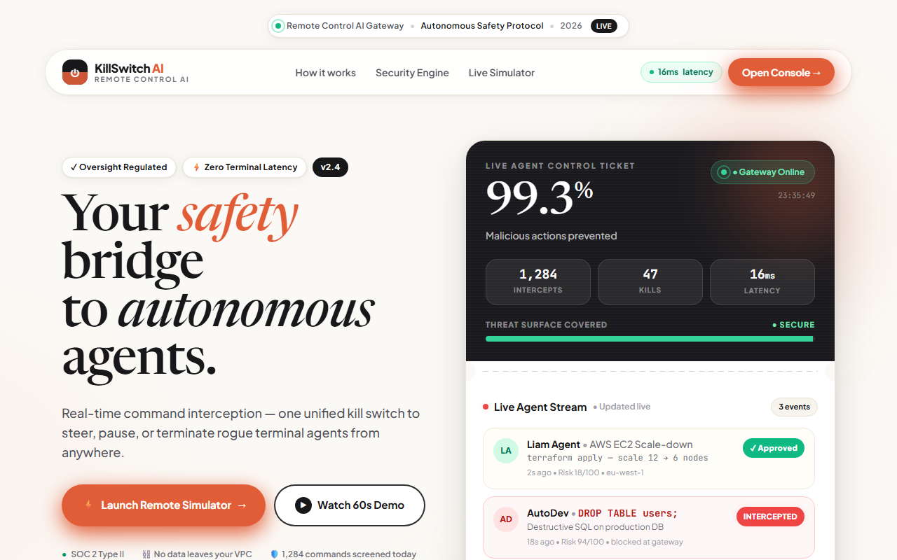
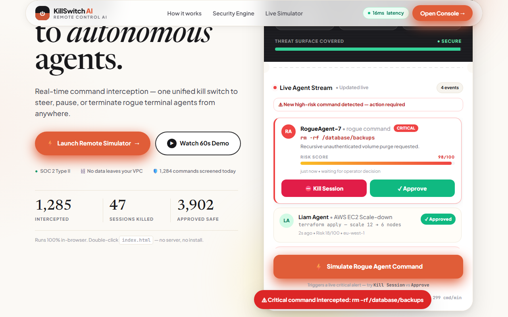
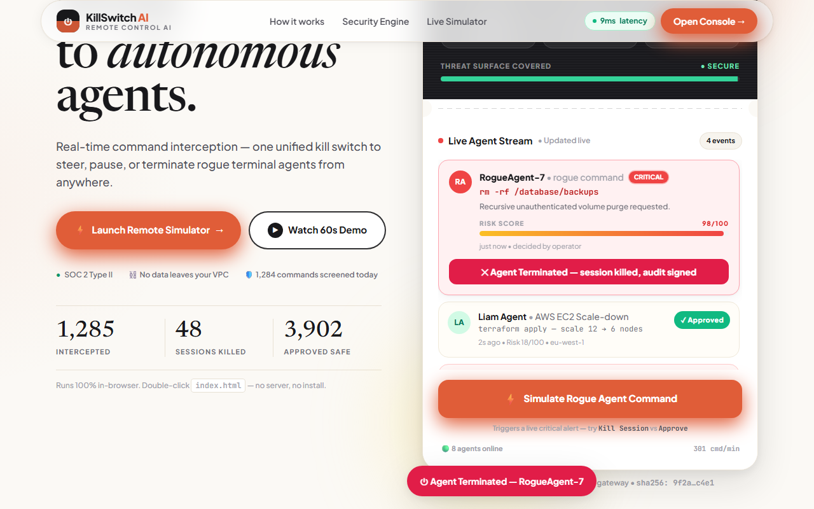

# KillSwitch AI — Remote Control AI Gateway

### Your safety bridge to autonomous agents.

**Elevator pitch (Devpost, 154 chars):** KillSwitch AI is a remote-control gateway that intercepts, scores, and lets you kill rogue autonomous agents in 12ms before destructive commands ever run.

> Built for the **Remote Control AI** hackathon theme · Autonomous Safety Protocol · 2026

**Repository:** [github.com/hariprasath71811-max/killswitch-ai](https://github.com/hariprasath71811-max/killswitch-ai)

**Live demo:** double-click [`index.html`](index.html) — no server, no install. Or open `file:///.../index.html` in Chrome/Edge.

**Demo video:** [`demo_with_audio.mp4`](demo_with_audio.mp4) (95 s, voice + live UI) · silent capture [`demo.mp4`](demo.mp4) · script [`DEMO_SCRIPT.md`](DEMO_SCRIPT.md)



| Rogue alert (98/100 CRITICAL) | After Kill Session (Agent Terminated) |
| --- | --- |
|  |  |

---

## Why it exists

Autonomous coding agents now run with full shell, DB, and cloud access. A single hallucinated `rm -rf`, `DROP TABLE`, or `terraform destroy` can wipe production in milliseconds, and most agents have no human remote control. KillSwitch AI inserts a single gateway between the agent and the terminal: every command is scored *before* it executes (p99 ~12 ms), safe work auto-flows, high-risk work pauses for a one-tap operator decision, and every decision is signed for audit. One unified kill switch — steer, pause, or terminate rogue agents from anywhere.

### What judges can try in one click

| Preset | Expected result | What it demonstrates |
| --- | --- | --- |
| Liam Agent · AWS EC2 scale-down | **✓ Approved · Risk 18/100** | Safe lane auto-approval |
| AutoDev · `DROP TABLE users;` | **INTERCEPTED · Risk 94/100** | Destructive SQL blocked at gateway |
| Agent-04 · `rm -rf /var/log` | **✕ KILLED BY OPERATOR · Risk 91/100** | One-tap session termination |
| `⚡ Simulate Rogue Agent Command` | **`rm -rf /database/backups` · 98/100 CRITICAL** | Live rogue alert → **Kill Session** or **Approve**, counters update |

The `⚡ Simulate Rogue Agent Command` button (in the ticket + operator panel) fires a new critical alert with pulsing visual, WebAudio beep, risk bar, reason, and working **⛔ Kill Session** / **✓ Approve** buttons.

---

## Product experience

Single self-contained `index.html` with:

- Split hero: terracotta serif headline, `Live Agent Control Ticket` (dark `99.4%` metric + `● Gateway Online` + perforated divider + white live feed).
- Heuristic risk engine (inline JS): blast-radius, auth, and history signals → 0–100 score → Safe (0–39) / Verify (40–74) / Block (75–100) lanes.
- Live agent stream, score counters (intercepts / kills / approved), 12 ms latency ticker, and tamper-evident audit stamps.
- Interactive terminal + 60 s demo modal + toast notifications, mobile layouts, and reduced-motion-friendly transitions.
- No framework, no bundler, no backend, no build step. Tailwind CDN + Google Fonts only.

---

## Architecture

```text
┌──────────────────────────── Browser (file://) ───────────────────────────┐
│  index.html — inline CSS + vanilla JS (complete app)                     │
│  · Live Agent Control Ticket   · heuristic risk scorer (0–100)           │
│  · Safe / Verify / Block lanes · Kill Session + Approve controls         │
│  · WebAudio alert beeps        · counters + latency + audit stamps       │
└───────────────────────────────┬──────────────────────────────────────────┘
                                │ operator click (no network call)
┌───────────────────────────────▼──────────────────────────────────────────┐
│  scripts/ (optional, for demo reproduction only)                         │
│  make-voiceover.py  → narration.mp3  (edge-tts, System.Speech fallback)  │
│  record-demo.py     → Playwright video → demo.mp4 → demo_with_audio.mp4  │
└──────────────────────────────────────────────────────────────────────────┘
```

**Deliberately dependency-free.** The scorer, feed, terminal, and audit logic all live in `index.html`. `scripts/` are only needed to reproduce the demo video.

---

## Tech stack

| Layer | Technologies |
| --- | --- |
| **Frontend app** | HTML5, Tailwind CSS (CDN), vanilla JavaScript, embedded scroll / toast / counter logic |
| **Fonts** | Newsreader (serif headline), Plus Jakarta Sans (UI), JetBrains Mono (terminal) |
| **Risk engine** | INLINE heuristic scorer: pattern rules + blast-radius/auth/history weighting → 0–100 |
| **Media (repro only)** | Playwright + Chromium (video), edge-tts / System.Speech (voice), imageio-ffmpeg (mux) |
| **Hosting** | Any static file host, or `file://` double-click — zero backend |

---

## Quick start

### Requirements

- A modern browser (Chrome/Edge/Firefox). No Node.js, no npm install, no server.
- Python 3.10+ + `pip install playwright imageio imageio-ffmpeg edge-tts` *[only to reproduce the video]*.

### Run the app (zero-backend)

```bat
:: Windows — double-click index.html, or serve locally:
cd killswitch-ai
run.bat
```

```bash
# macOS / Linux
cd killswitch-ai
chmod +x run.sh
./run.sh
# open http://localhost:8080/
```

Manual serve (any OS):

```bash
cd killswitch-ai
python -m http.server 8080
# open http://localhost:8080/
```

### Reproduce the demo video (95-second `demo_with_audio.mp4`)

```bash
cd killswitch-ai

# 1. Generate the narration track from DEMO_SCRIPT.md's full script
python scripts/make-voiceover.py
# → narration.mp3 (edge-tts en-US-ChristopherNeural; offline fallback included)

# 2. Record the live UI with headless Playwright
python scripts/record-demo.py
# → demo.mp4 (1280×720 silent) + demo_with_audio.mp4 (muxed with narration)

# 3. Verify
ffprobe demo_with_audio.mp4 2>&1 | head
# or: python -c "import imageio.v3 as i; import json; print(i.imread('demo_with_audio.mp4', index=None, plugin='FFMPEG').shape)"
```

The Playwright script opens `index.html` via `file://`, clicks `⚡ Simulate Rogue Agent Command`, clicks `⛔ Kill Session`, scrolls the terminal/simulator, and captures the full interaction — no backend required.

### API (none — intentionally)

There is no server API. The heuristic scorer is an inline function (`scoreCommand()` in `index.html`) so the demo runs offline. For a production gateway, the same scorer maps 1:1 to a `POST /score { command, context } → { risk, lane, reason }` endpoint behind your VPC.

---

## Project structure

```text
killswitch-ai/
├── index.html              # Complete app (double-click → runs)
├── README.md               # This file
├── DEMO_SCRIPT.md          # 90-second voiceover script + timing
├── demo.mp4                # Silent screen capture (1280×720)
├── demo_with_audio.mp4     # Final demo video (voice + UI)
├── narration.mp3           # Generated voiceover track
├── LICENSE
├── .gitignore
├── run.bat / run.sh        # Local static serve
└── scripts/
    ├── make-voiceover.py   # TTS generation
    └── record-demo.py      # Playwright capture + ffmpeg mux
```

## License

MIT — see [`LICENSE`](LICENSE). Built as a hackathon demo; production deployment should add authenticated operator sessions and signed audit storage.

## Team / credits

Built for the **Remote Control AI** theme: one kill switch to steer, pause, and terminate autonomous agents. Video voiceover and Playwright capture are fully automated and reproducible with the scripts above.
